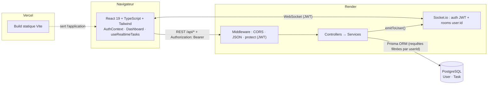
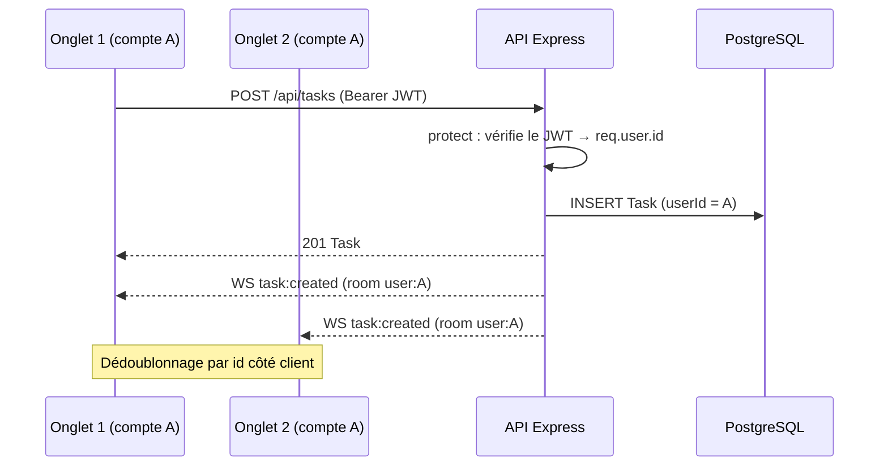
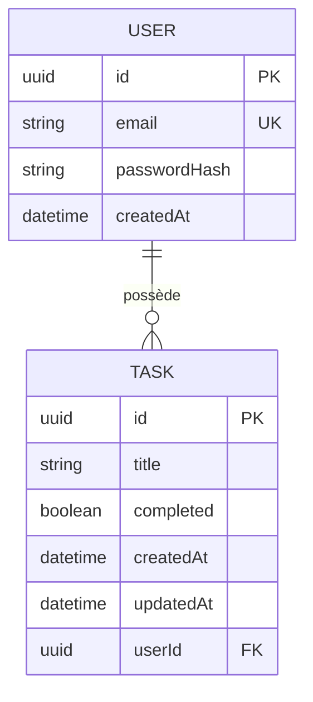

# Task Manager — Full-Stack TypeScript


Application web de gestion de tâches **multi-utilisateurs** avec authentification sécurisée et **synchronisation en temps réel** entre tous vos onglets et appareils. Projet de fin de parcours Mint Technologies : une application complète, typée de bout en bout (frontend, API, base de données) et déployée dans le cloud.

## 🔗 Liens

| | |
|---|---|
| **Application (frontend)** | `<URL Vercel à ajouter>` |
| **API (backend)** | `<URL Render à ajouter>` — santé : `<URL Render>/health` |
| **Démo vidéo** | `docs/demo.gif` (voir plus bas) |

> ⏱️ Le backend gratuit se met en veille après inactivité : la **première** requête peut prendre environ une minute.


## ✨ Fonctionnalités

- **Comptes utilisateurs** : inscription, connexion, déconnexion, session persistante (JWT).
- **Gestion des tâches** : créer, cocher, supprimer, avec mises à jour optimistes.
- **Isolation des données** : chaque utilisateur ne voit et ne modifie que ses propres tâches.
- **Temps réel (WebSockets)** : un changement fait dans un onglet apparaît instantanément dans les autres, avec reconnexion automatique et resynchronisation.
- **États d'interface soignés** : chargement, liste vide, erreur, retour utilisateur sur chaque échec.

## 🏗️ Architecture



### Cycle d'une requête : création d'une tâche



### Modèle de données



### Décisions de conception

- **Couches séparées** (routes → controllers → services) : la validation HTTP est isolée de l'accès aux données.
- **Isolation par construction** : tous les accès Prisma sont filtrés par `userId`. Une tâche d'autrui renvoie `404` (et non `403`) pour ne pas révéler son existence.
- **Un seul mécanisme d'authentification** pour REST et WebSocket (`lib/token.ts`).
- **Évènements idempotents** : le client qui agit reçoit aussi l'évènement sans créer de doublon.
- **Échec rapide** : le serveur refuse de démarrer sans `JWT_SECRET` valide.

## 🧰 Stack technique

| Couche | Technologies |
|---|---|
| Frontend | React 19, TypeScript, Vite, Tailwind CSS v3, socket.io-client |
| Backend | Node.js, Express 4, TypeScript, Socket.io |
| Base de données | PostgreSQL, Prisma ORM 6 (migrations versionnées) |
| Sécurité | bcryptjs (hachage), jsonwebtoken (JWT HS256), CORS configurable |
| Tests | Vitest, Supertest, socket.io-client |
| Déploiement | Vercel (frontend), Render (API), Neon ou Render PostgreSQL |

## 📁 Structure du dépôt

```
my-app/
├── frontend/                 # React + Vite + Tailwind
│   ├── vercel.json
│   └── src/
│       ├── components/       # TaskCard.tsx
│       ├── context/          # AuthContext.ts, AuthProvider.tsx
│       ├── hooks/            # useAuth.ts, useRealtimeTasks.ts
│       ├── lib/              # api.ts (fetch + JWT), socket.ts
│       ├── pages/            # AuthPage.tsx, Dashboard.tsx
│       └── types/            # Task, User, AuthResponse
├── backend/                  # Express + Prisma
│   ├── prisma/               # schema.prisma + migrations/
│   ├── src/
│   │   ├── controllers/      # authController.ts, task.controller.ts
│   │   ├── middleware/       # authMiddleware.ts (protect)
│   │   ├── routes/           # authRoutes.ts, task.routes.ts
│   │   ├── services/         # task.service.ts
│   │   ├── lib/              # prisma.ts, token.ts, origins.ts
│   │   ├── scripts/          # isolationDemo.ts, smokeTest.ts
│   │   ├── socket.ts         # Socket.io (auth, rooms, emitToUser)
│   │   ├── config.ts · app.ts · server.ts
│   └── tests/                # auth, isolation, WebSocket, CORS
├── postman/                  # collection Postman
├── docs/                     # DEPLOYMENT.md, demo.gif, captures
├── render.yaml               # Blueprint Render (optionnel)
└── README.md
```

## 🚀 Démarrage en local

**Prérequis** : Node.js 20+, PostgreSQL installé et démarré.

```bash
# 1. Cloner
git clone <url-du-depot>
cd my-app

# 2. Base de données
#    (psql) CREATE DATABASE taskmanager_db;

# 3. Backend
cd backend
cp .env.example .env        # renseignez DATABASE_URL et JWT_SECRET
npm install
npm run db:migrate          # crée les tables (donnez un nom, ex : init)
npm run dev                 # http://localhost:3001

# 4. Frontend (nouveau terminal)
cd frontend
cp .env.example .env
npm install
npm run dev                 # http://localhost:5173
```

Générer un `JWT_SECRET` :

```bash
node -e "console.log(require('crypto').randomBytes(48).toString('hex'))"
```

### Variables d'environnement

| Fichier | Variable | Rôle |
|---|---|---|
| `backend/.env` | `DATABASE_URL` | Chaîne de connexion PostgreSQL |
| `backend/.env` | `JWT_SECRET` | Secret de signature des JWT (16+ caractères, **obligatoire**) |
| `backend/.env` | `JWT_EXPIRES_IN` | Durée de validité du token (défaut `7d`) |
| `backend/.env` | `CORS_ORIGIN` | URL(s) du frontend autorisée(s), séparées par des virgules |
| `backend/.env` | `PORT` | Port du serveur (défaut 3001 ; fourni par l'hébergeur en production) |
| `frontend/.env` | `VITE_API_URL` | URL de l'API **avec** `/api` |
| `frontend/.env` | `VITE_SOCKET_URL` | (optionnel) URL WebSocket, par défaut l'origine de `VITE_API_URL` |

Les fichiers `.env` sont ignorés par Git ; seuls les `.env.example` sont versionnés.

## 📡 Référence de l'API

Base : `http://localhost:3001` · 🔒 = header `Authorization: Bearer <token>` requis.

| Méthode | Endpoint | Description | Corps | Réponse |
|---|---|---|---|---|
| `POST` | `/api/auth/register` | Crée un compte | `{ email, password (8+) }` | `201` `{ token, user }` |
| `POST` | `/api/auth/login` | Connexion | `{ email, password }` | `200` `{ token, user }` |
| `GET` | `/api/auth/me` 🔒 | Utilisateur courant | — | `200` `{ id, email }` |
| `GET` | `/api/tasks` 🔒 | Vos tâches (récentes d'abord) | — | `200` `Task[]` |
| `POST` | `/api/tasks` 🔒 | Crée une tâche | `{ title }` | `201` `Task` |
| `PATCH` | `/api/tasks/:id` 🔒 | Modifie titre et/ou état | `{ title?, completed? }` | `200` `Task` |
| `DELETE` | `/api/tasks/:id` 🔒 | Supprime une tâche | — | `204` |
| `GET` | `/health` | Santé du service | — | `200` `{ status, timestamp }` |

Erreurs (toujours `{ "error": "message" }`) : `400` validation · `401` token absent/invalide/expiré ou identifiants incorrects · `404` tâche introuvable **ou appartenant à un autre utilisateur** · `409` email déjà utilisé · `500` erreur serveur.

**WebSocket** (Socket.io, authentification par `auth: { token }`) — évènements serveur → client : `task:created` (tâche), `task:updated` (tâche), `task:deleted` (`{ id }`), reçus uniquement par les connexions du propriétaire.

```bash
# Exemple
curl -X POST http://localhost:3001/api/auth/register \
  -H "Content-Type: application/json" \
  -d '{"email":"alice@example.com","password":"password123"}'

curl -X POST http://localhost:3001/api/tasks \
  -H "Authorization: Bearer <token>" -H "Content-Type: application/json" \
  -d '{"title":"Learn Prisma"}'
```

Une collection Postman est fournie : `postman/task-manager.postman_collection.json` (le token est enregistré automatiquement après Register/Login).

## 🔐 Sécurité

- **Mots de passe** : hachés avec bcrypt (10 tours, sel intégré) ; seul `passwordHash` est stocké. Vérifiable avec `npx prisma studio` (valeurs `$2a$10$...`).
- **JWT** HS256, expiration configurable, algorithme imposé à la vérification.
- **Anti-énumération** : le login renvoie la même erreur que l'email existe ou non (avec un temps de calcul équivalent).
- **Isolation** : requêtes filtrées par `userId` (REST) et rooms privées (WebSocket).
- **CORS** restreint aux origines déclarées dans `CORS_ORIGIN`.
- **Secrets** uniquement dans les variables d'environnement de l'hébergeur ; aucun secret dans Git.
- **Limites connues** : token en `localStorage` (exposé en cas de XSS ; un cookie `httpOnly` serait préférable en production) et pas de limitation de débit (rate limiting) sur le login.

## 🧪 Tests

```bash
cd backend
npm test                    # 12 tests : auth, hachage, isolation A/B, WebSocket, CORS
npm run demo:isolation      # démo A/B contre un serveur lancé (voir isolation-log.txt)
npm run smoke -- <url-backend> <url-frontend>   # contrôle d'un déploiement en ligne
```

Les tests utilisent une base en mémoire (pas de PostgreSQL requis) et un vrai serveur Socket.io avec de vrais clients.

## ☁️ Déploiement

Frontend sur **Vercel**, API sur **Render**, base **PostgreSQL** (Neon ou Render). Les migrations s'appliquent automatiquement au démarrage (`prisma migrate deploy`). Guide pas à pas, variables d'environnement, vérifications et dépannage : **[docs/DEPLOYMENT.md](docs/DEPLOYMENT.md)**.

## 🧭 Pistes d'amélioration

- Cookie `httpOnly` + refresh tokens, limitation de débit sur l'authentification.
- Pagination et filtres sur les tâches, partage de tâches entre utilisateurs.
- Tests de bout en bout (Playwright) et intégration continue (GitHub Actions).

## 👤 Auteur

**[Votre nom]** — [LinkedIn](<lien>) · [GitHub](<lien>)
