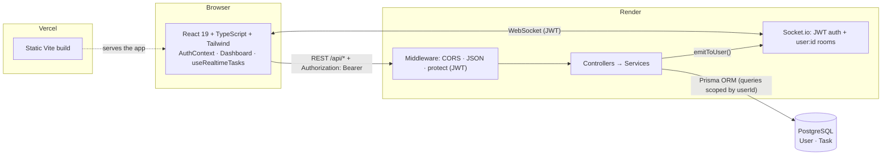
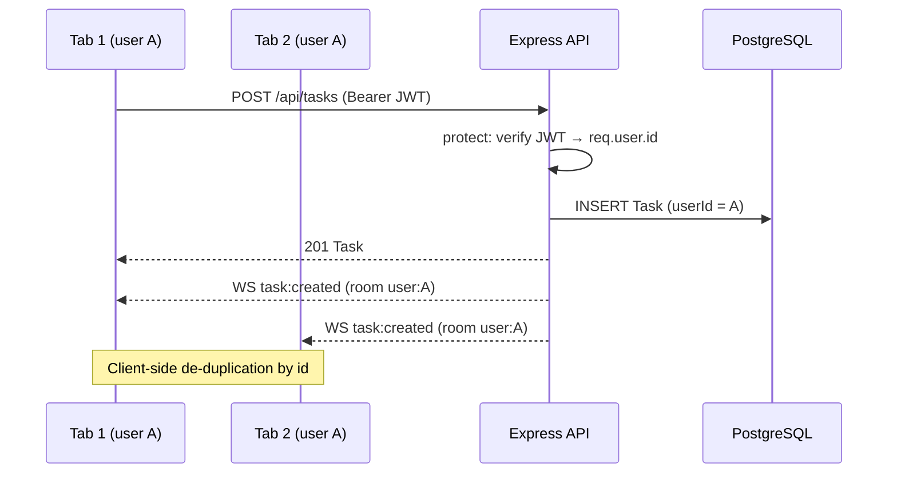
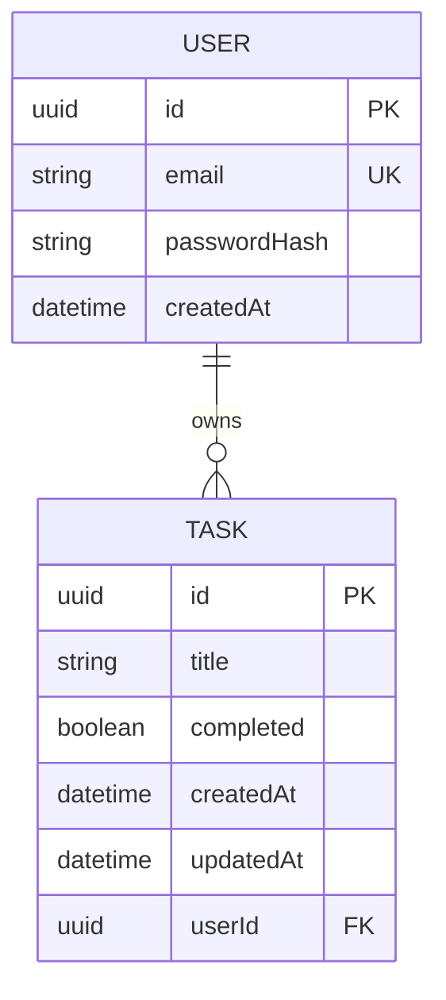

# Task Manager — Full-Stack TypeScript


A **multi-user** task management web application with secure authentication and **real-time synchronization** across all your tabs and devices. Built as the capstone of the Mint Technologies program: a complete application, typed end to end (frontend, API, database) and deployed to the cloud.

## 🔗 Links

| | |
|---|---|
| **Live app (frontend)** | `<add your Vercel URL>` |
| **Live API (backend)** | `<add your Render URL>` — health check: `<Render URL>/health` |
| **Demo** | `docs/demo.gif` (see below) |

> The free-tier backend goes to sleep after a period of inactivity: the **first** request can take about a minute to respond.


##  Features

- **User accounts**: sign up, log in, log out, persistent session (JWT).
- **Task management**: create, complete and delete tasks, with optimistic UI updates.
- **Data isolation**: each user can only see and modify their own tasks.
- **Real time (WebSockets)**: a change made in one tab instantly appears in the others, with automatic reconnection and resynchronization.
- **Polished UI states**: loading, empty list and error states, with user feedback on every failure.

##  Architecture



### Request lifecycle: creating a task



### Data model



### Design decisions

- **Layered backend** (routes → controllers → services): HTTP validation is kept separate from data access.
- **Isolation by construction**: every Prisma query is filtered by `userId`. Another user's task returns `404` (not `403`) so its existence is never revealed.
- **A single authentication mechanism** for both REST and WebSocket (`lib/token.ts`).
- **Idempotent events**: the client that performs an action also receives the event, without creating duplicates.
- **Fail fast**: the server refuses to start without a valid `JWT_SECRET`.

## Tech Stack

| Layer | Technologies |
|---|---|
| Frontend | React 19, TypeScript, Vite, Tailwind CSS v3, socket.io-client |
| Backend | Node.js, Express 4, TypeScript, Socket.io |
| Database | PostgreSQL, Prisma ORM 6 (versioned migrations) |
| Security | bcryptjs (hashing), jsonwebtoken (JWT HS256), configurable CORS |
| Testing | Vitest, Supertest, socket.io-client |
| Deployment | Vercel (frontend), Render (API), Neon or Render PostgreSQL |

##  Repository Structure

```
my-app/
├── frontend/                 # React + Vite + Tailwind
│   ├── vercel.json
│   └── src/
│       ├── components/       # TaskCard.tsx
│       ├── context/          # AuthContext.ts, AuthProvider.tsx
│       ├── hooks/            # useAuth.ts, useRealtimeTasks.ts
│       ├── lib/              # api.ts (fetch + JWT), socket.ts
│       ├── pages/            # AuthPage.tsx, Dashboard.tsx
│       └── types/            # Task, User, AuthResponse
├── backend/                  # Express + Prisma
│   ├── prisma/               # schema.prisma + migrations/
│   ├── src/
│   │   ├── controllers/      # authController.ts, task.controller.ts
│   │   ├── middleware/       # authMiddleware.ts (protect)
│   │   ├── routes/           # authRoutes.ts, task.routes.ts
│   │   ├── services/         # task.service.ts
│   │   ├── lib/              # prisma.ts, token.ts, origins.ts
│   │   ├── scripts/          # isolationDemo.ts, smokeTest.ts
│   │   ├── socket.ts         # Socket.io (auth, rooms, emitToUser)
│   │   ├── config.ts · app.ts · server.ts
│   └── tests/                # auth, isolation, WebSocket, CORS
├── postman/                  # Postman collection
├── docs/                     # DEPLOYMENT.md, demo.gif, screenshots
├── render.yaml               # Render Blueprint (optional)
└── README.md
```

##  Getting Started (Local)

**Prerequisites**: Node.js 20+, PostgreSQL installed and running.

```bash
# 1. Clone
git clone <repository-url>
cd my-app

# 2. Database
#    (psql) CREATE DATABASE taskmanager_db;

# 3. Backend
cd backend
cp .env.example .env        # fill in DATABASE_URL and JWT_SECRET
npm install
npm run db:migrate          # creates the tables (enter a name, e.g. init)
npm run dev                 # http://localhost:3001

# 4. Frontend (new terminal)
cd frontend
cp .env.example .env
npm install
npm run dev                 # http://localhost:5173
```

Generate a `JWT_SECRET`:

```bash
node -e "console.log(require('crypto').randomBytes(48).toString('hex'))"
```

### Environment Variables

| File | Variable | Purpose |
|---|---|---|
| `backend/.env` | `DATABASE_URL` | PostgreSQL connection string |
| `backend/.env` | `JWT_SECRET` | JWT signing secret (16+ characters, **required**) |
| `backend/.env` | `JWT_EXPIRES_IN` | Token lifetime (default `7d`) |
| `backend/.env` | `CORS_ORIGIN` | Allowed frontend URL(s), comma-separated |
| `backend/.env` | `PORT` | Server port (default 3001; provided by the host in production) |
| `frontend/.env` | `VITE_API_URL` | API URL **including** `/api` |
| `frontend/.env` | `VITE_SOCKET_URL` | (optional) WebSocket URL, defaults to the origin of `VITE_API_URL` |

`.env` files are ignored by Git; only the `.env.example` files are committed.

## 📡 API Reference

Base URL: `http://localhost:3001` ·  = `Authorization: Bearer <token>` header required.

| Method | Endpoint | Description | Body | Response |
|---|---|---|---|---|
| `POST` | `/api/auth/register` | Create an account | `{ email, password (8+) }` | `201` `{ token, user }` |
| `POST` | `/api/auth/login` | Log in | `{ email, password }` | `200` `{ token, user }` |
| `GET` | `/api/auth/me`  | Current user | — | `200` `{ id, email }` |
| `GET` | `/api/tasks`  | Your tasks (newest first) | — | `200` `Task[]` |
| `POST` | `/api/tasks`  | Create a task | `{ title }` | `201` `Task` |
| `PATCH` | `/api/tasks/:id`  | Update title and/or status | `{ title?, completed? }` | `200` `Task` |
| `DELETE` | `/api/tasks/:id`  | Delete a task | — | `204` |
| `GET` | `/health` | Service health check | — | `200` `{ status, timestamp }` |

Errors (always `{ "error": "message" }`): `400` validation · `401` missing/invalid/expired token or wrong credentials · `404` task not found **or owned by another user** · `409` email already registered · `500` server error.

**WebSocket** (Socket.io, authenticated with `auth: { token }`) — server → client events: `task:created` (task), `task:updated` (task), `task:deleted` (`{ id }`), received only by the owner's connections.

```bash
# Example
curl -X POST http://localhost:3001/api/auth/register \
  -H "Content-Type: application/json" \
  -d '{"email":"alice@example.com","password":"password123"}'

curl -X POST http://localhost:3001/api/tasks \
  -H "Authorization: Bearer <token>" -H "Content-Type: application/json" \
  -d '{"title":"Learn Prisma"}'
```

A Postman collection is included: `postman/task-manager.postman_collection.json` (the token is saved automatically after Register/Login).

##  Security

- **Passwords**: hashed with bcrypt (10 rounds, built-in salt); only `passwordHash` is stored. Verifiable with `npx prisma studio` (values start with `$2a$10$...`).
- **JWT**: HS256, configurable expiration, algorithm enforced at verification.
- **Anti-enumeration**: login returns the same error whether or not the email exists (with equivalent computation time).
- **Isolation**: queries scoped by `userId` (REST) and private rooms (WebSocket).
- **CORS** restricted to the origins declared in `CORS_ORIGIN`.
- **Secrets** live only in the hosting provider's environment variables; no secret is committed to Git.
- **Known limitations**: token stored in `localStorage` (exposed in case of XSS; an `httpOnly` cookie would be preferable in production) and no rate limiting on login.

##  Testing

```bash
cd backend
npm test                    # 12 tests: auth, hashing, A/B isolation, WebSocket, CORS
npm run demo:isolation      # A/B demo against a running server (see isolation-log.txt)
npm run smoke -- <backend-url> <frontend-url>   # checks a live deployment
```

Tests run against an in-memory database (no PostgreSQL required) and a real Socket.io server with real clients.

##  Deployment

Frontend on **Vercel**, API on **Render**, **PostgreSQL** on Neon or Render. Migrations are applied automatically on startup (`prisma migrate deploy`). Step-by-step guide, environment variables, verification and troubleshooting: **[docs/DEPLOYMENT.md](docs/DEPLOYMENT.md)**.

##  Possible Improvements

- `httpOnly` cookie + refresh tokens, rate limiting on authentication.
- Pagination and filters for tasks, task sharing between users.
- End-to-end tests (Playwright) and continuous integration (GitHub Actions).
- Internationalization (the user interface is currently in French).

##  Author

**[Your name]** — [LinkedIn](<link>) · [GitHub](<link>)
